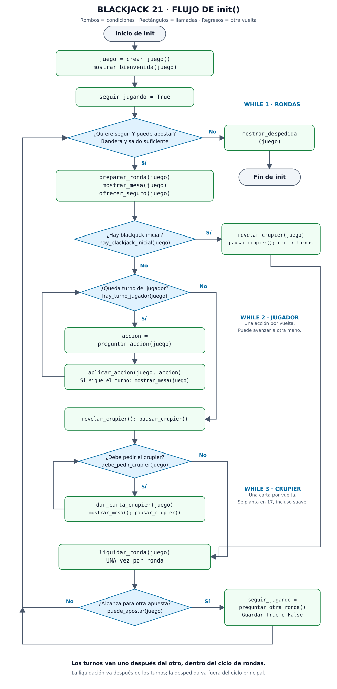
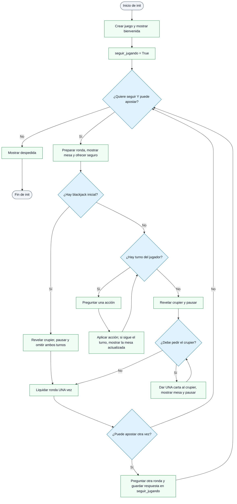

# Blackjack 21 — práctica del bucle `while`

**Unidad 2 · Temas Selectos de Tratamiento de Información**<br>
**Autor del juego original:** Carlos Gabriel Rodríguez Macías<br>
**Docente:** Athala Dulce Edith Gómez Arellano

Vamos a completar un juego de Blackjack 21 usando funciones que ya están listas. La actividad consiste en escribir **únicamente `init()`**, la función que organiza los turnos y repite las rondas. La puntuación, las cartas, los menús y los pagos ya están programados y comentados.

## 1. Archivos y ejecución

| Archivo | Para qué sirve |
| --- | --- |
| [blackjack21_practica.py](blackjack21_practica.py) | Código del estudiante. `init()` contiene las instrucciones pendientes. |
| [diagramas/flujo_init.svg](diagramas/flujo_init.svg) | Diagrama completo, visible sin instalar un renderizador Mermaid. |
| [diagramas/flujo_init.mmd](diagramas/flujo_init.mmd) | Fuente editable del mismo flujo en Mermaid. |

Necesitas **Python 3.8 o posterior** y una terminal. Se verificó con Python 3.12.3. Solo se usa `random`, que viene con Python; no hay que instalar paquetes.

Abre una terminal dentro de esta carpeta y ejecuta:

```bash
python3 blackjack21_practica.py
```

En Windows, si Python está disponible mediante el lanzador:

```powershell
py blackjack21_practica.py
```

Antes de completar `init()`, la práctica muestra un aviso y termina. Eso es lo esperado.

Puedes salir entre rondas contestando `n`. `Ctrl+C` interrumpe la sesión. Todas las fichas son ficticias; el saldo dura solo mientras el programa está abierto.

### Colores y emojis de la consola

El juego usa códigos ANSI como `\033[91m` para aplicar color sin instalar ninguna librería. Las constantes `ROJO`, `VERDE`, `AMARILLO`, `AZUL`, `MAGENTA` y `CIAN` permiten leer con claridad qué estilo se aplica. La función `pintar()` agrega el código solicitado y después `\033[0m` para que el color no afecte los mensajes siguientes.

Los colores aparecen al ejecutar el juego en una terminal compatible, incluida la terminal integrada de VS Code. Se desactivan automáticamente cuando la salida se envía a un archivo o a las pruebas. También puedes desactivarlos manualmente:

```bash
NO_COLOR=1 python3 blackjack21_practica.py
```

Las cartas usan los símbolos Unicode `♠`, `♥`, `♦` y `♣`. Se muestran como iconos de los palos, pero sin el selector de emoji que algunas terminales cuentan como una columna adicional. Así los marcos quedan derechos en VS Code. Corazones y diamantes se dibujan en rojo; picas y tréboles en cian para conservar el contraste tanto en terminales claras como oscuras.

La mesa separa cada interacción con una línea de 64 guiones. El saldo, la información del crupier, el número de mano, el total, la apuesta y el estado del turno aparecen en renglones diferentes. Esto permite identificar un dato sin tener que interpretar una sola línea extensa.

## 2. Qué vamos a aprender

Al terminar podrás:

- Elegir una condición que indique si un proceso debe repetirse.
- Usar una bandera booleana para continuar o terminar una sesión.
- Llamar a funciones y guardar sus valores de retorno.
- Organizar ciclos anidados: una ronda contiene los turnos del jugador y del crupier.
- Cambiar el estado dentro de un ciclo para que pueda terminar.
- Colocar cada operación en el nivel de indentación correcto.

Conviene conocer variables, `True` y `False`, `if/else`, `and`, `not`, funciones e indentación. **No necesitas cambiar las listas ni los diccionarios internos del juego.**

## 3. Cómo se juega en esta mesa

### Cartas y objetivo

Juegas contra el **crupier**, quien reparte y representa a la mesa. Debes conseguir un total mayor que el suyo sin pasar de 21. También ganas si el crupier se pasa y tu mano sigue válida.

La mesa usa **seis barajas de 52 cartas, sin comodines: 312 cartas**. Cada rango y palo aparece seis veces. Por eso ver dos ases de picas en una sesión es posible. El programa mezcla el zapato —el conjunto de barajas disponibles— y retira una carta cada vez que reparte. Al comenzar una nueva ronda, si quedan 110 cartas o menos, prepara otro zapato completo; las manos anteriores se descartan. No se rebaraja durante un turno.

Los palos se representan con iconos dentro de las cartas: `♠` = picas, `♥` = corazones, `♦` = diamantes y `♣` = tréboles. El palo no cambia el valor.

| Carta | Valor |
| --- | --- |
| 2 a 10 | El número de la carta. |
| J, Q, K | 10. |
| A | 1 u 11, usando el mejor total que no pase de 21. |

Ejemplos de ases:

- `A + 6 = 17 suave`: un as cuenta como 11.
- `A + 6 + 10 = 17 duro`: el as baja a 1 para evitar pasarse.
- `A + A + 9 = 21`: un as vale 11 y el otro vale 1.
- `A + A + K = 12`: ambos ases deben valer 1.

**Blackjack natural** significa as + carta de valor 10 en las dos cartas iniciales de una mano original. Un `7 + 7 + 7` es 21, pero no es blackjack. Un as + figura después de separar una mano también es 21 ordinario.

### Una ronda

1. Colocas una apuesta con tu saldo disponible: mínimo **50 fichas**, en cantidades enteras. Empiezas con **2000 fichas**.
2. Se reparte una carta al jugador, una al crupier, otra al jugador y otra al crupier. La segunda carta del crupier queda tapada; tampoco se muestra su total completo.
3. Si el crupier muestra un as, puede ofrecerse un seguro antes de comprobar el blackjack inicial.
4. Si alguien tiene blackjack inicial, se revelan las cartas y se paga la ronda directamente. Si ambos tienen blackjack, la apuesta principal empata.
5. Si no hay blackjack inicial, juegas tus manos y después juega el crupier.
6. Se liquidan todas las apuestas. Si te queda saldo suficiente, decides si quieres otra ronda.

### Acciones del jugador

El menú solo muestra las opciones permitidas en ese momento. Los números mantienen siempre su significado:

| Opción | Acción | Efecto y condición |
| --- | --- | --- |
| `1` | Pedir | Recibes una carta. Puedes pedir de nuevo mientras no alcances 21 ni te pases. |
| `2` | Plantarse | Conservas el total y terminas esa mano. |
| `3` | Doblar | Solo con dos cartas y saldo para otra apuesta igual: duplicas la apuesta, recibes **una** carta y terminas esa mano. Se permite después de separar, salvo ases separados. |
| `4` | Separar | Solo con dos cartas del mismo valor y saldo para otra apuesta igual: creas dos manos con apuestas independientes. J y K, por ejemplo, tienen el mismo valor. Puedes volver a separar hasta tener cuatro manos. |
| `5` | Rendirse | Solo con las dos cartas de la mano original, después de descartar blackjack del crupier: terminas y recuperas la mitad de la apuesta. No se permite después de pedir ni después de separar. |

Al separar un par, juegas primero la mano actual. La segunda mano recibe su siguiente carta cuando le toca el turno. Si una mano alcanza 21, se planta automáticamente. Si se pasa, pierde aunque el crupier se pase después.

**Ases separados:** reciben una carta adicional por mano y ambas manos se plantan. No puedes volver a separar esos ases, pedirles más cartas ni doblarlos. Un 21 de estas manos paga como victoria ordinaria.

### Turno del crupier

Esta mesa usa la regla **S17**:

- Con 16 o menos, el crupier pide otra carta.
- Con 17 o más, se planta, incluido el 17 suave (`A + 6`).
- Su decisión depende de su total y de si quedan manos por comparar. Por ejemplo, debe pedir con 16 aunque tú te hayas plantado en 12.
- Si todas tus manos se pasaron o se rindieron, revela su carta oculta pero no necesita seguir pidiendo.
- Después de revelar su mano y después de cada carta nueva, el programa espera `1.0` segundo. La constante `PAUSA_CRUPIER` permite cambiar esa duración desde un solo lugar.

### Seguro y pagos

El **seguro** es una apuesta independiente ofrecida con un as visible del crupier. En esta práctica es exactamente la mitad de la apuesta original y requiere saldo adicional. Paga **2:1** si el crupier tiene blackjack; en otro caso se pierde. Comprar seguro no convierte una derrota de la mano principal en victoria.

La apuesta principal se descuenta al colocarla. Los pagos devuelven la apuesta correspondiente más el premio cuando existe:

| Resultado | Si apostaste 50 | Cambio neto en tu saldo |
| --- | --- | --- |
| Victoria ordinaria, pago 1:1 | Regresan 100: tus 50 + 50 de premio. | +50 |
| Blackjack natural, pago 3:2 | Regresan 125: tus 50 + 75 de premio. | +75 |
| Empate | Regresan tus 50. | 0 |
| Derrota | No regresa nada. | −50 |
| Rendición | Regresan 25. | −25 |

Ejemplo independiente del seguro: apuestas 50 y compras seguro por 25. Si el crupier tiene blackjack y tu mano no, pierdes los 50 de la mano principal, pero el seguro devuelve 75 (25 propios + 50 de premio). El balance total de esa ronda es 0.

Una apuesta de 51 puede generar pagos con medias fichas: el blackjack devuelve 127.50 y la rendición devuelve 25.50. Internamente se guarda el dinero como enteros en **centésimas de ficha**; `5100` representa `51.00`. Esto evita errores de redondeo. `init()` no necesita hacer cálculos de pagos.

Estas son las decisiones de esta mesa educativa. Los límites de separación, rendición, seguro y la regla del 17 pueden variar entre mesas. Las reglas generales de reparto y puntuación se contrastaron con [Bicycle: Blackjack](https://bicyclecards.com/how-to-play/blackjack). Las distinciones de blackjack después de separar, ases separados y rendición se contrastaron con [Mohegan Pennsylvania: Gaming Guide, sección Blackjack](https://moheganpa.com/content/dam/poconodowns/pdf/playing/mpa-gaming-guide.pdf). Esta práctica fija sus propios límites: seis barajas, cuatro manos y seguro de media apuesta.

## 4. Qué es `while` y por qué lo necesitamos

`while` significa **mientras**. Python comprueba una condición antes de cada vuelta. Si es verdadera, ejecuta el bloque; al terminarlo vuelve a comprobarla. Si es falsa, continúa con la instrucción siguiente al ciclo.

Ejemplo independiente del juego:

```python
pendientes = 3
while pendientes > 0:
    print("Falta una tarea")
    pendientes -= 1
print("Terminamos")
```

La variable empieza en 3; cada vuelta la reduce. Al llegar a 0, la condición es falsa. Si no cambiara `pendientes`, el ciclo no terminaría. Si empezara en 0, el cuerpo se ejecutaría **cero veces**.

En el juego, los cambios pueden ocurrir **dentro de una función**. `aplicar_accion()` cambia la mano y el turno; la siguiente llamada a `hay_turno_jugador()` observa esos cambios. No hace falta incrementar un contador artificial.

Los tres ciclos que debes escribir tienen propósitos distintos:

| Ciclo | Qué repite | Condición que debes revisar | Qué permite terminarlo |
| --- | --- | --- | --- |
| Sesión | Una ronda completa. | Querer seguir **y** poder apostar. | La respuesta negativa cambia la bandera; perder saldo hace falsa la otra condición. |
| Jugador | Una acción sobre la mano que tiene el turno. | Que quede turno del jugador. | Plantarse, doblar, rendirse, llegar a 21 o pasarse; con separación puede continuar la siguiente mano. |
| Crupier | Repartir una carta al crupier. | Que la regla obligue al crupier a pedir. | Su total alcanza al menos 17, o no queda una mano válida para comparar. |

**El turno completo del jugador termina antes de empezar el del crupier.** Por eso sus dos ciclos están dentro del ciclo de rondas y uno después del otro. El ciclo del crupier no va dentro del ciclo de acciones del jugador.

`and` exige que ambas condiciones sean verdaderas. `not` invierte una respuesta booleana. Por ejemplo, si `hay_blackjack_inicial(juego)` devuelve `False`, su negación permite entrar a los turnos normales.

`break` sale del ciclo más cercano y `continue` empieza su siguiente vuelta. Puedes verlos en las funciones de apoyo, pero `init()` puede hacerse con condiciones y una bandera, sin utilizarlos.

## 5. Funciones listas para usar en `init()`

`juego` es el diccionario que devuelve `crear_juego()`. Conserva nombre, saldo, zapato, manos, turno y estadísticas. **Guárdalo una vez y pásalo a las funciones que lo soliciten.** No crees un juego nuevo en cada ronda: reiniciaría el saldo.

| Llamada | Retorno | Qué hace / cuándo se usa |
| --- | --- | --- |
| `crear_juego()` | Diccionario. | Pide el nombre y crea la sesión; se llama una vez, al inicio. |
| `mostrar_bienvenida(juego)` | `None`. | Muestra instrucciones y saldo inicial. |
| `puede_apostar(juego)` | `True` o `False`. | Comprueba si queda saldo para otra apuesta mínima. |
| `preparar_ronda(juego)` | `None`. | Pide y descuenta la apuesta, renueva el zapato si corresponde y reparte. La ronda anterior debe estar liquidada. |
| `mostrar_mesa(juego)` | `None`. | Muestra cartas, apuestas y saldo respetando la carta oculta. |
| `ofrecer_seguro(juego)` | `None`. | Ofrece seguro si corresponde; úsala una vez, antes de comprobar blackjack inicial. |
| `hay_blackjack_inicial(juego)` | `True` o `False`. | Comprueba ambas manos iniciales; con `True` se omiten los dos turnos. |
| `hay_turno_jugador(juego)` | `True` o `False`. | Avanza sobre manos terminadas; si toca una segunda mano separada, le da su carta pendiente. Indica si queda una mano por jugar. |
| `preguntar_accion(juego)` | Texto como `"1"` o `"2"`. | Muestra opciones válidas y repite la pregunta si la entrada es inválida. Guarda su retorno en `accion`. |
| `aplicar_accion(juego, accion)` | `None`. | Ejecuta una acción, actualiza cartas/apuestas y avanza el turno cuando corresponde. |
| `revelar_crupier(juego)` | `None`. | Revela la carta oculta y muestra la mesa al terminar el jugador o al detectar blackjack inicial. |
| `debe_pedir_crupier(juego)` | `True` o `False`. | Decide si debe recibir otra carta por la regla S17. |
| `dar_carta_crupier(juego)` | `None`. | Reparte una carta; el ciclo decidirá si se necesita otra. |
| `pausar_crupier()` | `None`. | Espera un segundo para que cada cambio del crupier pueda observarse antes de continuar. |
| `liquidar_ronda(juego)` | `None`. | Calcula resultados, devuelve fichas y actualiza estadísticas. Se llama una vez por ronda. |
| `preguntar_otra_ronda()` | `True` o `False`. | Pregunta si se desea continuar. Guarda el retorno en la bandera. |
| `mostrar_despedida(juego)` | `None`. | Muestra saldo final y resumen; se llama una vez al salir del ciclo de rondas. |

Una función con retorno `None` realiza una acción. Una función booleana permite tomar una decisión. Una función que devuelve un dato requiere guardarlo si lo vas a usar después:

```python
accion = preguntar_accion(juego)
aplicar_accion(juego, accion)
```

Preguntar y aplicar son pasos diferentes. Igualmente, llamar a `preguntar_otra_ronda()` sin guardar su retorno no cambia la bandera.

Para explorar las funciones internas, el código está organizado en ocho bloques: cartas y puntuación; entradas; preparación; jugador; crupier; pagos; presentación; `init`. Encontrarás funciones como `barajear()`, `calcular_total()` y `preguntar_opcion()`, pero no necesitas llamarlas directamente desde `init()`.

## 6. Diagrama de flujo de `init()`

Los **rombos** son decisiones. Los **rectángulos** son acciones. Las flechas que regresan a un rombo representan otra vuelta del ciclo. Cada respuesta debe seguir su flecha `Sí` o `No`.



La misma lógica está disponible en Mermaid, por si tu visor Markdown lo admite:



### Cómo leer los tres regresos

1. **Aplicar acción → ¿Hay turno del jugador?** No repitas una respuesta guardada: pregunta una nueva acción en cada vuelta. Al separar, la condición también administra el cambio de mano.
2. **Dar una carta → ¿Debe pedir el crupier?** Una carta puede cambiar su puntuación. Vuelve a consultar después de cada reparto, no antes de cada ronda solamente.
3. **Fin de ronda → ¿Quiere seguir y puede apostar?** Actualiza la bandera con la respuesta del jugador. Si ya no alcanza el saldo, la condición termina la sesión sin hacer otra pregunta.

El camino del blackjack inicial revela el crupier y llega directamente a la liquidación. **No pasa por los ciclos de turnos.** Todos los caminos de una ronda llegan a una sola liquidación.

## 7. Instrucciones para completar la tarea

1. Abre `blackjack21_practica.py` y busca `def init():`, casi al final.
2. Sustituye el mensaje de práctica pendiente por tu implementación. Puedes conservar los comentarios como recordatorio. No cambies las demás funciones ni el bloque `if __name__ == "__main__":`.
3. Antes de cualquier ciclo, guarda el resultado de `crear_juego()`, muestra la bienvenida y crea una bandera booleana que empiece en `True`.
4. Escribe el ciclo principal para repetir mientras el jugador quiera seguir **y** tenga saldo para apostar.
5. Dentro de ese ciclo, prepara la ronda, muestra la mesa y ofrece el seguro, en ese orden.
6. Consulta el blackjack inicial con `if/else`. Si no hay blackjack, organiza los dos turnos. Si lo hay, revela el crupier y omite ambos turnos.
7. Para el jugador, escribe un `while` cuya condición consulte si queda turno. La mesa inicial ya se mostró antes del ciclo. En cada vuelta pregunta la acción, guarda la respuesta y aplícala. Si todavía queda turno después de la acción, muestra la mesa actualizada antes de repetir. Las funciones harán avanzar la mano.
8. Cuando termine ese ciclo, revela al crupier y llama `pausar_crupier()`. Después escribe su `while`: si debe pedir, reparte **una** carta, muestra la mesa y vuelve a llamar `pausar_crupier()`. Así cada carta permanece visible un segundo antes de continuar. Vuelve a evaluar la condición en la siguiente vuelta.
9. Después del `if/else`, pero todavía dentro del ciclo de rondas, liquida la ronda **una sola vez**. Así pagan tanto el blackjack inicial como las rondas normales.
10. Si queda saldo para apostar, pregunta si desea otra ronda y guarda la respuesta en la bandera. Si no queda, la condición principal se encargará de salir.
11. Fuera del ciclo principal, muestra la despedida.
12. Ejecuta tu archivo y comprueba los casos de la siguiente sección. Revisa la indentación si un turno se repite fuera de lugar o no se ejecuta.

Pseudocódigo para planear antes de escribir Python:

```text
Crear sesión, saludar y activar la bandera de continuación.
MIENTRAS quiera seguir Y tenga saldo:
    Preparar una ronda, mostrar cartas y ofrecer el seguro.
    SI NO existe blackjack inicial:
        MIENTRAS exista turno del jugador:
            Preguntar y ejecutar una acción.
            SI todavía existe turno del jugador:
                Mostrar las cartas actualizadas.
        Revelar las cartas del crupier y hacer una pausa.
        MIENTRAS el crupier deba pedir:
            Repartirle una carta, mostrar la mesa y hacer una pausa.
    EN CASO CONTRARIO:
        Revelar las cartas del crupier y hacer una pausa.
    Liquidar la ronda.
    SI hay saldo para otra apuesta:
        Preguntar si quiere continuar y actualizar la bandera.
Mostrar la despedida.
```

El flujo esperado contiene tres `while` en `init()`. Puedes usar otros nombres para tus variables; conserva las llamadas y el orden de las operaciones. No agregues más ciclos para validar entradas: esas funciones ya lo hacen.

## 8. Cómo revisar tu entrega

Las cartas son aleatorias, por lo que algunos casos aparecerán después de varias rondas. Puedes revisar los comportamientos principales con la siguiente tabla.

| Prueba | Resultado esperado |
| --- | --- |
| Dejar el nombre vacío. | Se usa `Jugador`. |
| Apostar letras, 0, 49, decimales o más que el saldo. | Se explica el error y se vuelve a preguntar. |
| Escribir una opción de acción inválida. | Se vuelve a mostrar la pregunta; no cambia la mano ni el saldo. |
| Pedir varias veces. | Cambian las cartas y se pide una acción nueva en cada vuelta. |
| Plantarse. | Termina esa mano; después continúa la siguiente mano o el crupier. |
| Alcanzar 21 o pasarse. | Esa mano deja de pedir acciones automáticamente. |
| Blackjack inicial de cualquiera. | Se omiten ambos turnos y se paga una vez. |
| Doblar con saldo suficiente. | Se cobra otra apuesta, llega una sola carta y termina esa mano. |
| Separar un par. | Se juegan las manos por separado y se pagan individualmente. |
| Rendirse. | Regresa media apuesta; no se vuelve a preguntar una acción en esa mano. |
| Responder `s` después de una ronda. | Inicia otra con el saldo actualizado. |
| Responder `n`. | Sale del ciclo principal y muestra una despedida. |
| Quedar con menos de 50 fichas. | Termina la sesión sin pedir otra apuesta ni preguntar si desea continuar. |

Errores frecuentes:

- **El juego no termina:** revisa que guardaste el retorno de `preguntar_otra_ronda()` y que vuelves a consultar las condiciones de los turnos.
- **El saldo vuelve a 2000 en cada ronda:** creaste la sesión dentro del ciclo principal.
- **El jugador repite siempre la misma acción:** preguntaste antes del ciclo de acciones o no guardaste una respuesta nueva.
- **El crupier juega antes de que te plantes:** su ciclo quedó dentro del ciclo del jugador.
- **Sale “esta ronda ya fue liquidada”:** estás pagando dentro de un turno o dos veces por ronda.
- **Un blackjack permite seguir pidiendo:** el caso inicial debe pasar directamente a revelar y liquidar.
- **Sale `IndentationError`:** usa cuatro espacios por nivel y revisa los bloques que abre cada `while`, `if` o `else`.

## 9. Entrega y reflexión

Entrega **`blackjack21_practica.py` con tu `init()` terminada**, más las respuestas que solicite la docente. El archivo debe seguir conservando las funciones de apoyo.

Responde con tus palabras:

1. ¿Qué repite cada uno de tus tres ciclos?
2. ¿Qué provoca que la condición de cada ciclo se vuelva falsa?
3. ¿Por qué hay que guardar la respuesta de “otra ronda”?
4. ¿Por qué la liquidación va fuera de los dos ciclos de turnos y dentro del ciclo de rondas?
5. ¿Por qué el ciclo del crupier va después del ciclo del jugador?
6. ¿Qué cambia al separar un par y por qué el ciclo del jugador puede manejarlo sin programar otro ciclo en `init()`?

La meta es poder explicar tus condiciones y la ubicación de cada llamada, aunque tus nombres de variables difieran.
